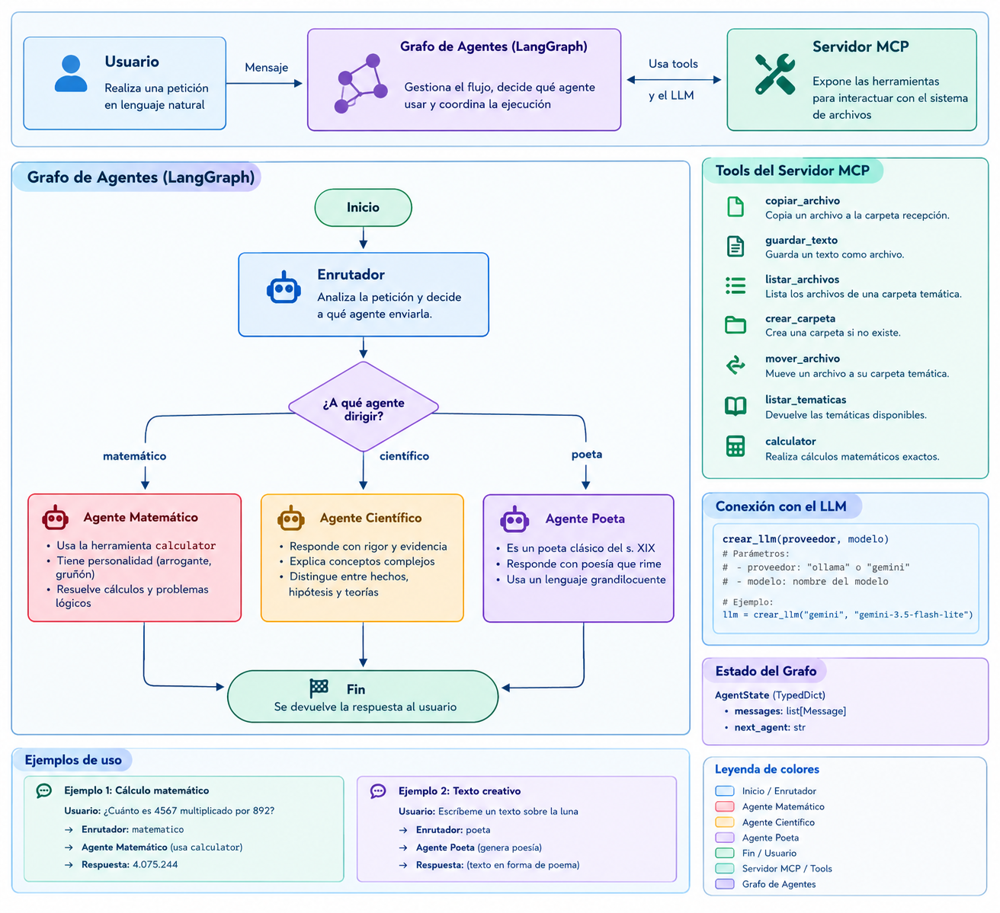
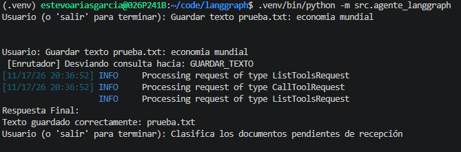
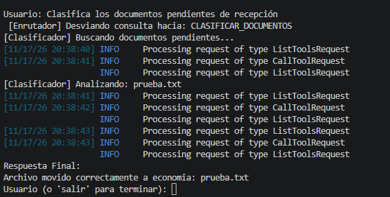
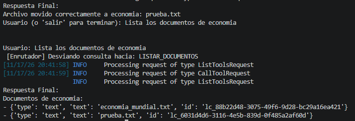
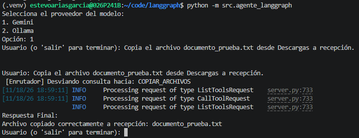
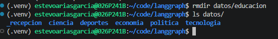
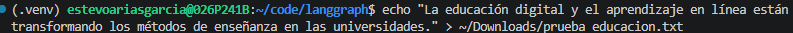
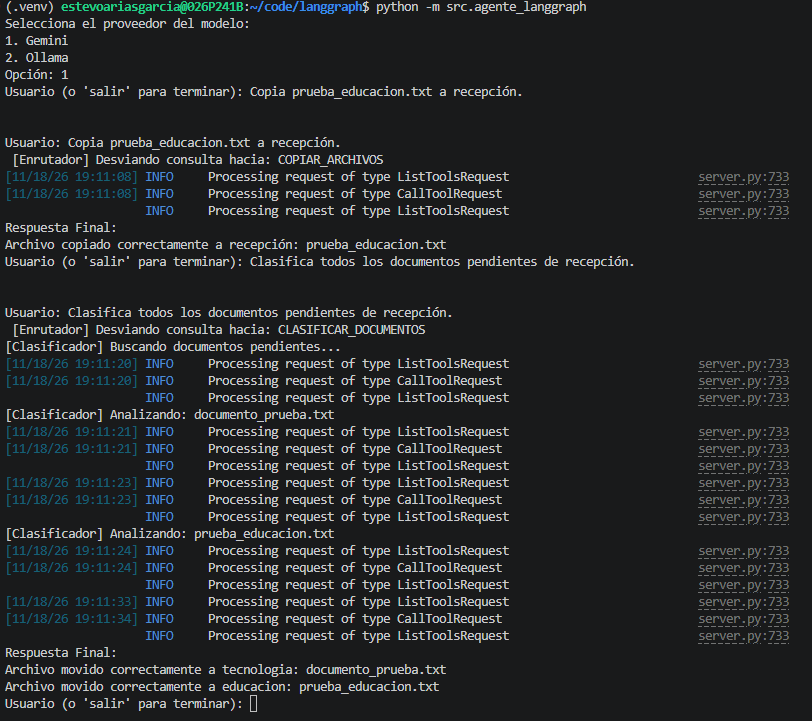

# Agente inteligente multiagente con LangGraph y MCP

## 1. Descripción del proyecto

Este proyecto implementa un sistema multiagente basado en **LangGraph**, **LangChain** y el protocolo **Model Context Protocol (MCP)**, utilizando un modelo de lenguaje Gemini como motor de razonamiento.

El sistema permite interactuar con diferentes agentes especializados mediante lenguaje natural. Un agente enrutador analiza cada petición del usuario y determina qué agente o funcionalidad debe ejecutarla.

La aplicación incorpora capacidades de razonamiento y generación de contenido, así como herramientas externas para la gestión automatizada de documentos y archivos.

El proyecto se divide en tres componentes principales:

- **Sistema multiagente (LangGraph):** coordina los diferentes agentes, mantiene el estado de la conversación y dirige las peticiones mediante un sistema de enrutamiento condicional.
- **Cliente MCP:** establece la comunicación entre LangGraph y los servidores MCP, descubre las herramientas disponibles y permite ejecutarlas de forma asíncrona.
- **Servidor MCP:** proporciona herramientas para gestionar documentos, copiar archivos, leer contenidos, guardar textos, clasificarlos y organizarlos en diferentes categorías.

### Funcionalidades principales

- Enrutamiento inteligente de consultas mediante un modelo de lenguaje.
- Agente matemático con una herramienta de cálculo.
- Agente científico para responder consultas especializadas.
- Agente poeta para generar contenido creativo.
- Consulta y listado de documentos por categorías.
- Clasificación automática de documentos mediante Gemini.
- Copia de archivos desde un directorio externo a una carpeta de recepción.
- Lectura de documentos almacenados en recepción.
- Creación y almacenamiento de archivos de texto.
- Organización automática de documentos mediante herramientas MCP.

El objetivo es mostrar cómo combinar una arquitectura multiagente con herramientas externas, separando la lógica de razonamiento de las operaciones que realiza el sistema de archivos.

---

## 2. Arquitectura y funcionamiento del sistema

La arquitectura se basa en un grafo de estados implementado con **LangGraph**, que coordina la ejecución de los diferentes agentes y funcionalidades.

El sistema utiliza un enrutador central que analiza el mensaje del usuario mediante Gemini y selecciona el nodo encargado de resolver la petición.

### 2.1. Arquitectura general



La arquitectura está formada por tres capas:

**1. Sistema multiagente (LangGraph)**

Es el núcleo de la aplicación. Recibe las peticiones del usuario y utiliza un nodo enrutador para determinar qué agente debe ejecutarlas.

El grafo dispone de ocho destinos:

| Nodo | Responsabilidad |
|---|---|
| `matematico` | Resuelve operaciones matemáticas utilizando una calculadora. |
| `poeta` | Genera contenido literario y poético. |
| `cientifico` | Responde preguntas de carácter científico. |
| `listar_documentos` | Consulta los documentos existentes en una categoría. |
| `clasificar_documentos` | Analiza y clasifica documentos pendientes de recepción. |
| `copiar_archivos` | Copia archivos al directorio de recepción. |
| `leer_archivo` | Lee el contenido de archivos de recepción. |
| `guardar_texto` | Guarda textos proporcionados por el usuario. |

El enrutador utiliza Gemini para clasificar la petición y establece el destino mediante la variable `next_agent`.

El grafo utiliza conexiones condicionales para dirigir la ejecución al nodo seleccionado. Una vez ejecutado, el flujo finaliza y devuelve la respuesta al usuario.

**2. Cliente MCP**

El archivo `cliente_mcp.py` implementa la comunicación entre LangGraph y el servidor MCP.

Para ello utiliza `MultiServerMCPClient`, perteneciente a `langchain-mcp-adapters`.

La comunicación se establece mediante transporte `stdio`, iniciando el servidor MCP utilizando el mismo intérprete de Python del entorno virtual.

El cliente realiza tres operaciones principales:

- Descubre las herramientas disponibles mediante `get_tools()`.
- Localiza la herramienta solicitada por su nombre.
- Ejecuta la operación mediante `ainvoke()` y devuelve su resultado a LangGraph.

**3. Servidor MCP**

El servidor está implementado con `FastMCP` y se encarga de proporcionar las herramientas de gestión documental.

Las herramientas se registran mediante el decorador `@mcp.tool()`, permitiendo que el cliente MCP las descubra y ejecute.

El servidor proporciona siete herramientas:

| Herramienta | Descripción |
|---|---|
| `copiar_archivo` | Copia un archivo desde el directorio de origen a recepción. |
| `leer_archivo` | Lee el contenido de un archivo de recepción. |
| `guardar_texto` | Guarda un texto como archivo dentro de recepción. |
| `crear_carpeta` | Crea una carpeta correspondiente a una categoría permitida. |
| `mover_archivo` | Traslada un documento desde recepción a una categoría. |
| `listar_archivos` | Devuelve los documentos existentes en una categoría. |
| `listar_recepcion` | Lista los documentos pendientes de clasificación. |

### 2.2. Flujo de ejecución

El funcionamiento general sigue esta secuencia:

1. El usuario introduce una petición en el terminal.
2. LangGraph recibe el mensaje y actualiza el estado del grafo.
3. El nodo enrutador consulta a Gemini para identificar la intención del usuario.
4. Se selecciona el nodo correspondiente mediante enrutamiento condicional.
5. Si la operación necesita herramientas MCP, el nodo correspondiente invoca al cliente MCP.
6. El cliente descubre y ejecuta la herramienta solicitada en el servidor.
7. El resultado vuelve al nodo de LangGraph.
8. El grafo devuelve la respuesta final al usuario.

### 2.3. Flujo de clasificación documental

Uno de los procesos principales del proyecto es la clasificación automática de documentos.

Este proceso combina el razonamiento de Gemini con las herramientas proporcionadas por el servidor MCP.

El flujo es el siguiente:

1. El usuario solicita clasificar los documentos pendientes.
2. LangGraph selecciona el nodo `clasificar_documentos`.
3. Se invoca `listar_recepcion` para obtener los archivos pendientes.
4. Se utiliza `leer_archivo` para recuperar el contenido de cada documento.
5. Gemini analiza el contenido y determina su categoría.
6. Se valida que la categoría devuelta pertenezca a las categorías permitidas.
7. Se ejecuta `mover_archivo` para trasladar el documento a su carpeta correspondiente.
8. LangGraph devuelve el resultado de las operaciones.

Las categorías disponibles son:

- Deportes.
- Tecnología.
- Ciencia.
- Economía.
- Política.
- Educación.

Este mecanismo permite automatizar la organización documental sin necesidad de que el usuario clasifique manualmente cada archivo.

### 2.4. Ejemplo práctico: guardar y clasificar un documento

El siguiente ejemplo muestra el recorrido de un texto desde su creación hasta su clasificación:

1. Se guarda `prueba.txt` con el contenido `economia mundial`. El documento queda en recepción, pendiente de clasificación.

   

2. Se solicita clasificar los documentos pendientes. El agente analiza `prueba.txt` y lo mueve a la categoría `economia`.

   

3. Se consulta el contenido de la categoría `economia` para verificar que el documento ya está allí.

   


### 2.5. Ejemplo práctico: Elegir el tipo de modelo y copiar un archivo de downloads a recepción.

Se busca en la carpeta `downloads` el archivo .txt que demanda la petición que hacemos en el input. Se encuentra el archivo y se guarda en recepción. El server nos permite la opción de aplicar más procesos (clasificación, etc) o de salir. Elegimos la opción de salir.

   

---

### 2.6 Creación de la carpeta educación mediante el movimiento de un .txt

Queremos comprobar que, cuando una categoría no tiene carpeta (ni ningún archivo), puede crearse al traer un .txt que pertenece a dicha caragoría. en este caso, borramos la carpeta `educación` con todo lo que tiene dentro y creamos en descargas un .txt sobre la educación. Dicho .xt sufrirá los siguientes procesos:

- Importación de descargas a `_recepcion`.
- Lectura y clasificación en la categoría `educacion`. 
- Creación de la carpeta "Educación" por no existir y movimiento del .txt a dicha carpeta.

Veámoslo con imágenes:

Nos cercioramos de borrar la carpeta "Educación": 

   

Creamos en descargas el .txt con el siguiente texto: 

"La educación digital y el aprendizaje en línea están transformando los métodos de enseñanza en las universidades."

   

Corremos el agente dándole las siguientes instrucciones:

1. Que elija Gemini
2. Que copie el prueba_educacion.txt a recepción
3. Que lea los archivos de recepción (que en este momento sólo tenemos prueba_educación.txt) y los clasifique. El propio proceso de clasificación ya incluye la creación de la carpeta "Educación" y el movimiento de educacion.txt a dicha carpeta.



## 3. Estructura del repositorio

La organización del proyecto separa la lógica de los agentes, la comunicación con MCP, las herramientas del servidor y los documentos gestionados.

```text
langgraph/
│
├── .gitignore
├── readme.md
│
├── datos/
│   ├── _recepcion/
│   ├── ciencia/
│   ├── deportes/
│   ├── economia/
│   ├── tecnologia/
│   ├── politica/
│   └── educacion/
│
├── img/
│   ├── arquitectura.png
│   └── ...
│
└── src/
    ├── __init__.py
    ├── agente_langgraph.py
    ├── cliente_mcp.py
    ├── llm.py
    │
    └── server/
        ├── __init__.py
        └── server.py
```

### Descripción de los directorios y archivos

**`src/agente_langgraph.py`**

Contiene la implementación principal del sistema multiagente:

- Definición del estado `AgentState`.
- Configuración del modelo de lenguaje.
- Implementación del nodo enrutador.
- Definición de los ocho nodos de ejecución.
- Construcción y compilación del grafo.
- Bucle interactivo para recibir peticiones del usuario.

**`src/cliente_mcp.py`**

Implementa el cliente MCP utilizando `MultiServerMCPClient`.

Se encarga de iniciar la comunicación con el servidor, descubrir sus herramientas y ejecutar las operaciones solicitadas por los nodos de LangGraph.

**`src/llm.py`**

Contiene la configuración y creación del modelo de lenguaje utilizado por los agentes.

**`src/server/server.py`**

Implementa el servidor MCP mediante `FastMCP`.

Define las siete herramientas disponibles para la gestión documental y las operaciones sobre el sistema de archivos.

**`datos/`**

Almacena los documentos gestionados por el sistema.

- `_recepcion/`: directorio de entrada para documentos pendientes de clasificación.
- `ciencia/`: documentos científicos.
- `deportes/`: documentos deportivos.
- `economia/`: documentos económicos.
- `tecnologia/`: documentos tecnológicos.
- `politica/`: documentos políticos.
- `educacion/`: documentos educativos.

**`img/`**

Contiene las imágenes utilizadas en la documentación y los recursos gráficos del proyecto.

**`.gitignore`**

Evita incorporar al repositorio archivos sensibles y temporales, como variables de entorno, entornos virtuales y archivos compilados de Python.


